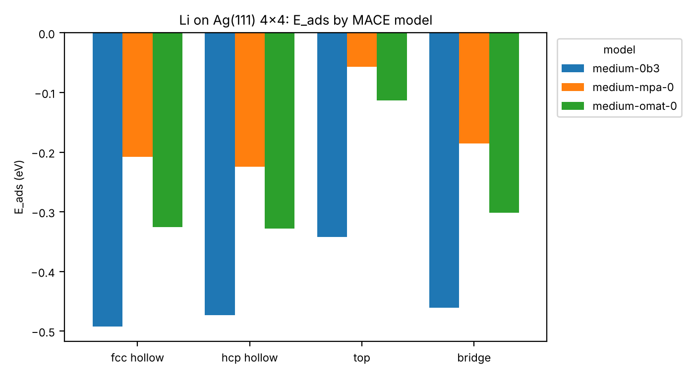

# Calculation

adsorption energy calculation

사전학습 범용 머신러닝 포텐셜(uMLIP) MACE로 Cu(111)과 Ag(111) 표면 위 Li 원자 1개의 흡착 에너지를 자리별로 계산한다. GPU 없이 CPU만으로 실행한다.

- Cu(111): 아래 [결과](#결과)와 [결과 검증](#결과-검증)
- Ag(111): [Ag(111) 결과](#ag111-결과), Cu와의 비교는 [Cu(111) vs Ag(111)](#cu111-vs-ag111)
- Ag가 Cu보다 Li를 약하게 잡는 결과가 계산 실수인지, 모델 문제인지 점검: [원인 점검](#원인-점검-ag-vs-cu)

## 실행 방법

```bash
python3 -m venv .venv
source .venv/bin/activate
pip install torch --index-url https://download.pytorch.org/whl/cpu   # CPU 전용 PyTorch
pip install -r requirements.txt
python adsorption.py
```

- 처음 실행할 때 MACE 체크포인트(약 76 MB)를 GitHub release에서 `~/.cache/mace/`로 자동으로 받는다.
- 표면 금속, 흡착 원자, 슬랩 크기, 층수, 진공 두께, 고정 층수, 수렴 기준, 모델은 `adsorption.py` 맨 위 변수에서 바꾼다.

다른 모델로 같은 계산을 하고 결과를 검증·비교하려면:

```bash
python adsorption.py --model medium-mpa-0  --out results/models/medium-mpa-0
python adsorption.py --model medium-omat-0 --out results/models/medium-omat-0
python verify.py results results/models/medium-mpa-0 results/models/medium-omat-0
```

다른 표면 금속(fcc)은 `--metal`로 지정한다. Ag(111) 결과는 이렇게 만들었다:

```bash
python adsorption.py --metal Ag --out results/Ag111
python adsorption.py --metal Ag --model medium-mpa-0  --out results/Ag111/models/medium-mpa-0
python adsorption.py --metal Ag --model medium-omat-0 --out results/Ag111/models/medium-omat-0
python verify.py --out results/Ag111 results/Ag111 results/Ag111/models/medium-mpa-0 results/Ag111/models/medium-omat-0
```

> 참고: 이번 실행 환경(Claude Code 클라우드 세션)에서는 `download.pytorch.org`가 네트워크 정책으로 막혀 있었다. 그래서 PyPI 기본 `torch` 휠(`2.14.1+cu130`)을 설치했다. GPU가 없으니 CUDA는 쓰지 않았고(`torch.cuda.is_available() == False`) 계산은 모두 CPU에서 했다.

## 계산 조건

| 항목 | 값 |
|---|---|
| 모델 | MACE-MP-0b3 medium (`mace_mp(model="medium-0b3")`, [mace_mp_0b3 release](https://github.com/ACEsuit/mace-mp/releases/tag/mace_mp_0b3)) |
| 소프트웨어 | mace-torch 0.3.16, torch 2.14.1, ase 3.29.0, e3nn 0.4.4, float64 |
| 하드웨어 | CPU 4 스레드, GPU 없음 |
| 표면 | Cu(111), 4×4, 4층(64 원자), 진공 15 Å(ASE `fcc111` 기준 위아래 각각), 아래 2층 고정 |
| 격자상수 | MACE로 최적화한 Cu fcc a = 3.614 Å |
| 흡착 원자 | Li 1개, 초기 높이 2.0 Å |
| 흡착 자리 | fcc hollow, hcp hollow, top, bridge |
| 최적화 | BFGS, fmax = 0.05 eV/Å (bulk는 셀까지 포함해 0.01 eV/Å) |
| 기준 에너지 | 깨끗한 슬랩(같은 조건으로 최적화), Li bcc bulk 원자당 에너지(a = 3.417 Å, −1.9008 eV/atom) |

E_ads = E(slab+Li) − E(slab) − E(Li bulk, 원자당)

E_ads가 음수이면, Li가 bulk 금속 Li로 있을 때보다 Cu 표면에 흡착했을 때 더 안정하다는 뜻이다.

## 결과

| 흡착 자리 | E_ads (eV) | 표면에서 Li까지 높이 (Å) | BFGS steps | 계산 시간 (s) |
|---|---:|---:|---:|---:|
| fcc hollow | −0.537 | 2.061 | 4 | 5.5 |
| **hcp hollow** | **−0.563** | 2.051 | 4 | 4.1 |
| top | −0.364 | 2.022 | 12 | 11.1 |
| bridge | −0.527 | 2.068 | 5 | 4.8 |

- 높이는 최적화 후 Li의 z 좌표에서 맨 위 Cu 층 평균 z를 뺀 값이다.
- 자리 간 안정성 순서는 hcp ≳ fcc > bridge ≫ top이다. hcp와 fcc의 차이(약 26 meV)는 모델 오차 범위 안일 수 있다.
- 최적화하는 동안 Li의 수평 이동은 모두 0.01 Å 이하였다. top과 bridge는 대칭 때문에 수평 힘이 0이라 그 자리에 머문 것이다. 아래 [결과 검증](#결과-검증)에서 Li를 옆으로 밀고 다시 최적화해 보니, 두 자리 모두 hollow로 미끄러졌다. 즉 둘 다 안정한 흡착 자리가 아니다.

**계산 시간**(CPU 4 스레드): bulk 기준 1.3 s, 깨끗한 슬랩 1.5 s(초기 힘이 이미 fmax보다 작아 0 step), 흡착 4개 자리 합계 25.5 s다. 모델 로딩까지 포함한 전체 실행은 약 38 s다(모델 다운로드 시간 제외).


### 결과 파일 (`results/`)

| 파일 | 내용 |
|---|---|
| `adsorption_energies.csv` | 자리별 E_ads, 높이, 수평 이동, step 수, 시간, 총에너지 |
| `adsorption_energies.png` | 자리별 E_ads 막대그래프 |
| `Cu111_Li_<site>.traj`, `clean_slab.traj` | BFGS 최적화 궤적(ASE trajectory, 마지막 프레임이 최종 구조) |
| `POSCAR/POSCAR_<name>` | 최종 구조(VASP POSCAR, direct 좌표) |
| `logs/*.log` | BFGS 로그 |
| `run_info.json` | 모델, 패키지 버전, 설정, 기준 에너지 |
| `geometry_check.csv` | Li–Cu 최근접 거리, 수평 이동, 최종 자리 판정, 높이 정의별 값 (`verify.py`) |
| `lattice_check.csv` | 기준 격자상수 확인 (`verify.py`) |
| `perturbation_check.csv`, `perturbed_*.traj` | Li를 옆으로 민 뒤 재최적화한 결과 (`verify.py`) |
| `model_comparison.csv`, `model_comparison.png` | 세 모델의 E_ads 비교 |
| `models/medium-mpa-0/`, `models/medium-omat-0/` | 다른 모델로 계산한 같은 구성의 결과 |

## 결과 검증

`verify.py`로 확인했다. 아래 표의 값은 별도 언급이 없으면 MACE-MP-0b3 medium 결과다.

### 1. Li–Cu 거리, 수평 이동, 자리 판정

| 시작 자리 | d1 (Å) | d2 (Å) | d3 (Å) | 최적화 중 수평 이동 (Å) | 최종 자리 판정 |
|---|---:|---:|---:|---:|---|
| fcc hollow | 2.557 | 2.557 | 2.557 | 0.000 | fcc hollow |
| hcp hollow | 2.550 | 2.550 | 2.550 | 0.000 | hcp hollow |
| top | 2.240 | 3.232 | 3.232 | 0.000 | top |
| bridge | 2.487 | 2.487 | 2.987 | 0.012 | bridge |

- d1–d3는 Li에서 가장 가까운 Cu 원자 3개까지의 거리(주기 경계 포함)다. 거리 패턴도 각 자리의 배위수와 맞다. hollow는 같은 거리 3개, bridge는 2개, top은 1개다.
- 최종 자리 판정은 최적화 후 Li의 xy 위치에서 가장 가까운 기준점으로 정했다. 기준점은 top(1층 Cu 위), bridge(1층 Cu–Cu 중점), hcp(2층 Cu 위), fcc(3층 Cu 위)다.
- **최적화 중에는 bridge와 top 모두 미끄러지지 않았다.** 하지만 이는 대칭 때문에 수평 힘이 정확히 0이어서 BFGS가 대칭을 깨지 못한 결과다. 그 자리가 안정하다는 뜻이 아니다.

**섭동 시험**: Li를 옆으로 0.2 Å 밀고 fmax 0.01 eV/Å로 다시 최적화했다. hollow와 top은 x축에서 17° 방향으로 밀었다. bridge는 두 Cu를 잇는 축에 수직인 양쪽(±)으로 각각 밀었다.

| 시작 자리 (민 방향) | MP-0b3 | MPA-0 | OMAT-0 |
|---|---|---|---|
| fcc hollow | fcc로 복귀 | fcc로 복귀 | fcc로 복귀 |
| hcp hollow | hcp로 복귀 | hcp로 복귀 | hcp로 복귀 |
| top | **fcc로 이동 (1.47 Å)** | **fcc로 이동 (1.49 Å)** | **fcc로 이동 (1.48 Å)** |
| bridge (+⊥) | **hcp로 이동 (0.71 Å)** | **fcc로 이동 (0.72 Å)** | **hcp로 이동 (0.72 Å)** |
| bridge (−⊥) | bridge 근처(0.2 Å)에서 멈춤* | **hcp로 이동 (0.72 Å)** | **fcc로 이동 (0.71 Å)** |

- **top은 세 모델 모두 불안정하다.** 조금만 밀어도 fcc hollow로 미끄러진다. 표의 top E_ads는 안정한 흡착 상태가 아니라 대칭으로 고정된 구조의 에너지다.
- **bridge도 안정한 흡착 자리가 아니다.** 어느 모델에서든 적어도 한 방향으로는 hollow로 미끄러진다. bridge는 fcc와 hcp 사이를 잇는 경로의 안장점에 해당한다.
- \* MP-0b3의 bridge(−⊥)는 추가로 확인했다. Li의 xy를 bridge→fcc 직선 위에 고정하고 나머지를 최적화하며 에너지를 따라가 보았다. 그 결과 E_ads는 −0.530(bridge) → −0.528(0.1–0.2 Å) → −0.539 eV(fcc, 0.72 Å)로, 약 2 meV짜리 작은 언덕이 있었다. 섭동 계산은 이 언덕 꼭대기(힘 0.009 eV/Å)에서 수렴 판정이 난 것이다. 2 meV는 모델 정확도보다 훨씬 작은 차이라 의미를 두기 어렵다.
- hollow 자리들은 다시 최적화해도 원래 자리에서 0.05 Å 안쪽으로 돌아왔고, 에너지 변화도 3 meV 이하였다. 다만 표면 위 퍼텐셜 에너지 곡면이 매우 평평해서, fmax 0.05로는 위치가 0.2 Å 정도 어긋난 채로 수렴 판정이 나기도 했다.

### 2. 높이 정의

README와 `adsorption_energies.csv`의 "높이"는 **Li의 z − 맨 위 Cu 층(16개 원자) 평균 z**(`h_layer`)다. 비교를 위해 두 가지 정의를 더 계산했다.

| 자리 | h_layer: 맨 위 층 평균 기준 (Å) | h_coord: 배위 Cu 평균 기준 (Å) | Li 바로 아래 Cu | h_below: 바로 아래 Cu 기준 (Å) |
|---|---:|---:|---|---:|
| fcc hollow | 2.061 | 2.082 | 3층 Cu (xy 0.00 Å) | 6.240 |
| hcp hollow | 2.051 | 2.070 | 2층 Cu (xy 0.00 Å) | 4.160 |
| top | 2.022 | 2.240 | 1층 Cu (xy 0.00 Å) | 2.240 |
| bridge | 2.068 | 2.118 | 2층 Cu (xy 0.73 Å) | 4.178 |

- `h_coord`는 Li와 결합한 Cu(hollow는 3개, bridge는 2개, top은 1개)의 평균 z를 기준으로 잰 높이다. Li가 있으면 바로 밑의 Cu가 조금 아래로 눌리기 때문에 `h_layer`보다 0.02–0.22 Å 크다. top에서 차이가 가장 크다.
- `h_below`는 xy가 가장 가까운 Cu 중 가장 위에 있는 원자를 기준으로 잰 높이다. hollow와 bridge 자리에서는 Li 바로 아래가 맨 위 층이 아니라 2층·3층 Cu여서, 이 값은 표면 위 높이로 쓸 수 없다. top 자리에서만 `h_below` = `h_coord` = Li–Cu 결합 길이(2.240 Å)로 의미가 있다.

### 3. 기준 격자상수

| 항목 | 사용한 값 | 실험값 (실온) | 어떻게 얻었나 | 확인 |
|---|---:|---:|---|---|
| Cu fcc a | 3.6140 Å | 3.615 Å | MACE로 bulk 셀 최적화 (`FrechetCellFilter` + BFGS) | a × 0.99 / 1.01에서 에너지가 각각 +4.9 / +4.5 meV/atom 높아 a가 최소점이다. 슬랩 POSCAR 셀에서 거꾸로 계산한 a도 3.6140 Å로 같다. |
| Li bcc a | 3.4165 Å | 3.51 Å | MACE로 bulk 셀 최적화 | ±1%에서 +0.8 meV/atom으로 최소점이다. E(Li bulk)/atom = −1.9008 eV |

- 두 격자상수 모두 **실험값이 아니라 같은 모델로 최적화한 값**이다. 슬랩, 흡착 구조, 기준 bulk가 모두 같은 모델의 평형 격자 위에서 계산되도록 맞춘 것이다.
- 모델별 최적 격자상수: MPA-0는 Cu 3.6392 / Li 3.4271 Å, OMAT-0는 Cu 3.6327 / Li 3.4265 Å다. 각 모델은 자기 격자상수로 슬랩을 다시 만들었다.
- 세 모델 모두 Li bcc 격자상수를 실험값보다 약 2.5% 작게 예측한다. 학습 데이터의 DFT(PBE) 값과 비슷한 경향이다.

### 4. 모델 비교

| 자리 | MACE-MP-0b3 medium | MACE-MPA-0 medium | MACE-OMAT-0 medium |
|---|---:|---:|---:|
| fcc hollow | −0.537 | −0.420 | −0.464 |
| hcp hollow | **−0.563** | **−0.422** | **−0.467** |
| top* | −0.364 | −0.253 | −0.330 |
| bridge* | −0.527 | −0.392 | −0.456 |
| hcp − fcc (meV) | −26 | −2 | −3 |
| 높이 h_layer, hcp (Å) | 2.051 | 2.056 | 2.081 |

E_ads 단위는 eV다. \* top과 bridge는 안정한 흡착 자리가 아니다(1번 참고).


- **세 모델 모두 순서가 같다.** hcp ≈ fcc > bridge > top이다. hollow 자리가 가장 안정하고, top이 가장 불리하다.
- **절대값은 모델마다 0.1 eV 넘게 다르다.** hollow 기준 MP-0b3 −0.56, OMAT-0 −0.47, MPA-0 −0.42 eV다. 이 차이가 사전학습 uMLIP의 불확실성 규모를 보여준다.
- fcc와 hcp의 차이는 MPA-0과 OMAT-0에서 2–3 meV로 사실상 0이다. MP-0b3만 26 meV로 hcp를 선호한다. 따라서 **fcc와 hcp 중 어디가 더 안정한지는 이 계산으로 결론 낼 수 없다.**
- OMAT-0 medium은 Academic Software License(ASL) 모델이다. 실행하면 라이선스 동의 문구가 출력된다.
- 계산 시간(4개 자리 최적화 합계): MP-0b3 25.5 s, MPA-0 46.3 s, OMAT-0 116.1 s다. 단, MPA-0와 OMAT-0는 다른 검증 계산과 CPU를 함께 쓰면서 돌았기 때문에 시간이 부풀려져 있다. 세 모델 모두 medium 크기라 단독으로 돌리면 비슷할 것으로 예상하지만 직접 확인하지는 않았다. 실제로 Ag(111)을 하나씩 따로 돌렸을 때는 세 모델 모두 23–24 s였다.

## Ag(111) 결과

Cu(111)과 같은 조건이다: 4×4, 4층(64 원자), 진공 15 Å, 아래 2층 고정, BFGS fmax 0.05 eV/Å, Li bcc bulk 기준. 격자상수와 Li 기준 에너지는 모델마다 같은 모델로 최적화한 값을 썼다. 결과 파일은 `results/Ag111/`에 있고, 구성은 `results/`와 같다(다른 모델 결과는 `results/Ag111/models/`).

### E_ads와 높이

| 자리 | MP-0b3 E_ads (eV) | MPA-0 E_ads (eV) | OMAT-0 E_ads (eV) | 높이 h_layer, MP-0b3 (Å) | 계산 시간, MP-0b3 (s) |
|---|---:|---:|---:|---:|---:|
| fcc hollow | **−0.492** | −0.208 | −0.326 | 2.099 | 4.7 |
| hcp hollow | −0.473 | **−0.224** | **−0.328** | 2.089 | 5.2 |
| top* | −0.342 | −0.057 | −0.113 | 2.253 | 6.7 |
| bridge* | −0.461 | −0.185 | −0.302 | 2.129 | 6.8 |
| hcp − fcc (meV) | +19 | −16 | −3 | | |

\* top과 bridge는 안정한 흡착 자리가 아니다(아래 섭동 시험 참고).



- 4개 자리 최적화에 걸린 시간 합계는 MP-0b3 23.4 s, MPA-0 24.2 s, OMAT-0 23.8 s다. 이번에는 다른 작업과 겹치지 않게 하나씩 돌렸다.
- **hollow가 가장 안정하고, top이 가장 불리하다.** 세 모델 모두 같다.
- **fcc와 hcp 중 어디가 더 안정한지는 모델마다 다르다.** MP-0b3는 fcc를 19 meV 선호하고, MPA-0는 hcp를 16 meV, OMAT-0는 hcp를 3 meV 선호한다. Cu와 마찬가지로 이 계산으로는 결론 낼 수 없다.
- 절대값은 모델 간 차이가 Cu보다 더 크다. hollow 기준으로 −0.22 ~ −0.49 eV, 약 0.27 eV 차이다.

### 검증 (MP-0b3)

| 시작 자리 | 가장 가까운 Ag 3개까지 거리 (Å) | 최적화 중 수평 이동 (Å) | h_coord (Å) | 섭동 시험 결과 (세 모델 공통) |
|---|---|---:|---:|---|
| fcc hollow | 2.739 / 2.739 / 2.739 | 0.000 | 2.131 | fcc로 복귀 |
| hcp hollow | 2.734 / 2.734 / 2.734 | 0.000 | 2.122 | hcp로 복귀 |
| top | 2.464 / 3.672 / 3.672 | 0.000 | 2.464 | **fcc로 이동 (1.69–1.70 Å)** |
| bridge | 2.662 / 2.662 / 3.271 | 0.009 | 2.193 | **+⊥는 fcc로, −⊥는 hcp로 이동 (0.81–0.83 Å)** |

- Cu처럼 원래 최적화에서는 대칭 때문에 아무 자리도 미끄러지지 않았다. 하지만 0.2 Å 밀어주면 top과 bridge는 세 모델 모두 hollow로 이동했다. Cu에서 보였던 0b3 bridge의 작은 언덕 같은 예외는 Ag에서는 없었다.
- 기준 격자상수:

  | 모델 | Ag a (Å) | 실험값 대비 |
  |---|---:|---:|
  | MP-0b3 | 4.1608 | +1.8% |
  | MPA-0 | 4.1609 | +1.8% |
  | OMAT-0 | 4.1477 | +1.5% |

  실험값은 4.086 Å이고, 세 모델 모두 MACE로 최적화한 값이다. ±1%에서 에너지가 4–5 meV/atom 높아 최소점인 것도 확인했다. Cu와 달리 Ag는 실험값보다 1.5–1.8% 크게 나오는데, PBE가 Ag 격자상수를 과대평가하는 경향과 같은 방향이다.
- `verify.py` 수정 사항: Ag의 bridge 자리에서는 Li 아래 두 Ag 원자가 2.94 Å에서 3.02–3.04 Å로 벌어진다. 원래 코드는 bridge 기준점을 만들 때 0.1 Å보다 많이 벌어진 원자쌍을 빼버려서, 이 bridge를 hollow로 잘못 판정했다. 허용 오차를 최근접 거리의 25%로 넓혀 고쳤다. 고친 코드로 Cu 검증도 다시 돌렸고, Cu 결과 CSV는 이전과 완전히 같다.

## Cu(111) vs Ag(111)

가장 안정한 hollow 자리의 E_ads (eV):

| 모델 | Cu(111) | Ag(111) | Ag − Cu |
|---|---:|---:|---:|
| MP-0b3 | −0.563 (hcp) | −0.492 (fcc) | +0.07 |
| MPA-0 | −0.422 (hcp) | −0.224 (hcp) | +0.20 |
| OMAT-0 | −0.467 (hcp) | −0.328 (hcp) | +0.14 |

- **세 모델 모두 Li는 Ag(111)보다 Cu(111)에 더 강하게 흡착한다.** 이 경향은 모델과 무관하게 같다.
- 하지만 그 차이의 크기는 모델마다 0.07–0.20 eV로 다르다. 그래서 "얼마나 더 강한지"는 이 계산으로 정할 수 없고 DFT 검증이 필요하다.
- Li 높이(맨 위 층 평균 기준)는 Ag에서 2.04–2.10 Å로, Cu의 2.05–2.09 Å과 비슷하다. Ag–Li 거리(2.68–2.74 Å)는 Cu–Li 거리(2.55–2.58 Å)보다 길지만, 대신 Ag 표면의 hollow가 더 넓어서 Li가 그만큼 더 깊이 들어간다.

## 원인 점검 (Ag vs Cu)

DFT 문헌에서는 Ag가 Cu보다 Li를 0.5–0.7 eV 더 강하게 흡착한다고 하는데, 위 결과는 반대로 나왔다. 그래서 이것이 계산 실수인지 모델 문제인지 확인했다.

> 이 문헌값(0.5–0.7 eV)의 원 출처는 이번 작업에서 찾지 못했다. 웹 검색에서는 Li를 Ag(111)와 Cu(111)에 흡착시킨 PBE 결과를 나란히 비교한 자료가 나오지 않았고, arxiv.org와 datadryad.org는 이 환경에서 접속이 안 됐다. 아래 비교는 이 값을 그대로 기준으로 놓고 진행했다.

참고로 E_ads(Ag) − E_ads(Cu)를 계산하면 Li 기준 에너지가 서로 상쇄된다. 따라서 Ag − Cu의 부호는 Li 기준을 bulk로 잡든 고립 원자로 잡든 바뀌지 않는다. 두 금속에 같은 기준만 쓰면 된다.

스크립트:
- `diagnose.py`: 1–3번 점검, 교차 확인 표 정리
- `crosscheck.py`: 4번 교차 확인
- 결과는 `results/diagnosis/`, `results/crosscheck/`에 있다.

```bash
python diagnose.py setup      # 1. 설정 점검
python diagnose.py surface    # 2. bulk 격자상수, 표면 에너지
python diagnose.py subsurf    # 3. 치환/침입형 Li
python crosscheck.py <family>:<model>   # 4. 모델별 가상환경에서 실행
python diagnose.py cross      # 4. 결과 표
```

### 1. 설정 점검

| 금속 | 모델 | 슬랩 격자상수 a (Å) | 깨끗한 슬랩 최적화 (BFGS step) | 고정 원자 (깨끗한 슬랩 / Li 슬랩) | 원자 수 | 층 간격 d12 / d23 / d34 (Å) | 이상적 층 간격 a/√3 (Å) | 셀 a1 = a2 (Å) | 셀 c (Å) | 진공 간격 (Å) |
|---|---|---:|---:|---|---:|---|---:|---:|---:|---:|
| Cu | MP-0b3 | 3.6140 | 0 | 32 / 32 | 64 | 2.087 / 2.087 / 2.087 | 2.087 | 10.222 | 36.26 | 30.00 |
| Cu | MPA-0 | 3.6392 | 2 | 32 / 32 | 64 | 2.084 / 2.106 / 2.101 | 2.101 | 10.293 | 36.30 | 30.01 |
| Cu | OMAT-0 | 3.6327 | 4 | 32 / 32 | 64 | 2.073 / 2.080 / 2.097 | 2.097 | 10.275 | 36.29 | 30.04 |
| Ag | MP-0b3 | 4.1608 | 0 | 32 / 32 | 64 | 2.402 / 2.402 / 2.402 | 2.402 | 11.769 | 37.21 | 30.00 |
| Ag | MPA-0 | 4.1609 | 0 | 32 / 32 | 64 | 2.402 / 2.402 / 2.402 | 2.402 | 11.769 | 37.21 | 30.00 |
| Ag | OMAT-0 | 4.1477 | 0 | 32 / 32 | 64 | 2.395 / 2.395 / 2.395 | 2.395 | 11.731 | 37.18 | 30.00 |

- **격자상수**는 모두 같은 모델로 bulk 셀을 최적화한 값이다(`FrechetCellFilter` + BFGS). 실험값은 쓰지 않았다.
- **깨끗한 슬랩**은 Li 슬랩과 같은 층수, 같은 고정 원자(아래 2층, 같은 인덱스), 같은 진공으로 따로 최적화했다.
  - 단, 6개 중 4개는 시작할 때부터 힘이 fmax 0.05보다 작아서 0 step으로 끝났다. 즉 표면 이완이 사실상 반영되지 않았다.
  - 이 영향을 확인하려고 모든 구조를 fmax 0.01로 다시 최적화했다(3번, 4번 계산). fcc hollow E_ads는 최대 13 meV 바뀌었고(Ag, OMAT-0), Ag − Cu는 0b3 +0.045 → +0.043, MPA-0 +0.212 → +0.209, OMAT-0 +0.138 → +0.154 eV였다. 부호와 크기 모두 그대로다.
- **진공**: ASE `fcc111(vacuum=15)`는 슬랩 위아래에 각각 15 Å을 두므로 실제 슬랩 사이 간격은 30 Å이다. 두 금속 모두 같다.
- **코드**: `adsorption.py`에서 Cu와 Ag가 다른 부분은 `METAL` 변수 하나뿐이다. 그 밖에 금속에 따라 갈라지는 분기는 없다. `run_info.json`의 설정도 금속을 빼면 모두 같다(`results/diagnosis/setup_check.csv`).

→ **설정에서 Cu와 Ag를 다르게 처리한 계산 실수는 없다.**

### 2. Ag 기본 물성

| 모델 | Ag a (Å) | Ag(111) γ (J/m²) | Cu a (Å) | Cu(111) γ (J/m²) |
|---|---:|---:|---:|---:|
| MACE-MP-0b3 | 4.161 | **0.517** | 3.614 | 1.363 |
| MACE-MPA-0 | 4.161 | 0.703 | 3.639 | 1.228 |
| MACE-OMAT-0 | 4.148 | 0.695 | 3.633 | 1.241 |
| PBE 문헌 (참고) | ≈ 4.15–4.16 | ≈ 0.6–0.7 | ≈ 3.63 | ≈ 1.3 |

- γ는 대칭 1×1 슬랩(5, 7, 9층, 모든 원자 최적화)으로 계산했다: γ = (E_slab − N·E_bulk) / 2A. 7층과 9층의 차이는 0.001 J/m² 이하로 수렴했다(`results/diagnosis/surface_energy.csv`).
- PBE 문헌값은 이번 작업에서 원 논문으로 확인하지 못했다. 표의 값은 흔히 인용되는 범위다. Ag(111)의 0.6–0.7 J/m²는 검색으로 찾은 slab 연구의 0.32 eV/표면 원자를 J/m²로 환산(약 0.69)해 맞춰본 값이다. DFT 비교용으로 쓰려면 원 출처를 확인해야 한다.
- **Ag 격자상수**는 세 모델 모두 PBE 값과 맞는다. 실험값(4.086 Å)보다 1.5–1.8% 큰 것은 PBE의 특성이다.
- **Ag(111) 표면 에너지**는 MPA-0와 OMAT-0가 PBE 범위 안에 있다. 반면 MP-0b3는 0.52 J/m²로 약 25% 낮다. MP-0b3는 Ag 표면을 너무 안정하게 보는데, 이것은 Ag 위 흡착을 약하게 만드는 쪽으로 작용할 수 있다. 다만 Ag − Cu 차이가 가장 작은 모델이 바로 0b3(+0.04 eV)이므로, 이것이 부호를 설명하지는 않는다.

### 3. Li가 표면 안으로 들어간 구조 (MACE, fmax 0.01)

에너지 기준은 E_ads와 같다(Li bcc bulk). 치환 구조는 빠져나간 금속 원자 1개가 bulk로 간다고 보고 계산했다:

- 침입형: E = E(구조) − E(깨끗한 슬랩) − μ_Li
- 치환: E = E(구조) + μ_M − E(깨끗한 슬랩) − μ_Li

| 금속 | 모델 | 표면 위 fcc hollow | 1층 치환 | 1–2층 팔면체 침입 | 1–2층 사면체 침입 | 가장 안정 |
|---|---|---:|---:|---:|---:|---|
| Cu | MP-0b3 | −0.536 | **−0.603** | +1.605 | +1.916 | 치환 |
| Cu | MPA-0 | −0.415 | −0.409 | +1.897 | +2.177 | 흡착 ≈ 치환 |
| Cu | OMAT-0 | **−0.466** | −0.424 | +1.804 | +2.068 | 흡착 |
| Ag | MP-0b3 | −0.493 | **−0.688** | +0.753 | +1.120 | 치환 |
| Ag | MPA-0 | −0.206 | **−0.547** | +0.688 | +0.996 | 치환 |
| Ag | OMAT-0 | −0.312 | **−0.547** | +0.777 | +1.118 | 치환 |

단위는 eV다.

- **Ag에서는 세 모델 모두 Li가 1층 Ag 원자를 치환하는 쪽이 표면 위 흡착보다 0.2–0.34 eV 더 안정하다.** 치환된 Li는 Ag 층과 높이가 같다(Li z − 맨 위 층 = −0.01 ~ 0.00 Å). Li와 Ag는 원자 크기가 비슷해서 Ag 격자에 잘 들어맞기 때문이다.
- Cu에서는 치환과 흡착이 비슷하다(차이 −0.07 ~ +0.04 eV). 치환된 Li는 Cu 층보다 0.3–0.55 Å 튀어나온다. Li가 Cu보다 커서 Cu 격자에 잘 맞지 않는다.
- 1–2층 사이 침입형은 두 금속 모두 +0.7 ~ +2.2 eV로 매우 불리하다. 그래도 Ag가 Cu보다 약 1 eV 덜 불리하다.
- 각 금속에서 가장 안정한 상태끼리 비교하면 Ag − Cu = **−0.08 (0b3), −0.13 (MPA-0), −0.08 (OMAT-0) eV**로 부호가 뒤집힌다. 즉 MACE는 "표면 위 흡착"으로는 Cu를, "표면에 섞여 들어가는 것(합금화)"까지 포함하면 Ag를 더 선호한다.

구조는 `results/diagnosis/structures/`에 POSCAR로 저장했다.

### 4. 다른 계열 uMLIP 교차 확인

`crosscheck.py`로 Cu(111)와 Ag(111)에서 fcc hollow 흡착과 1층 치환을 같은 조건으로 계산했다.
- 조건: 4×4, 4층, 진공 15 Å, 아래 2층 고정, fmax 0.01, Li bcc 기준
- 격자상수는 각 모델로 최적화한 값을 썼다.
- MACE도 이 스크립트로 다시 계산했는데, 3번의 값과 소수점 넷째 자리까지 같았다.

| 계열 | 모델 (패키지 버전) | E_ads fcc Cu | E_ads fcc Ag | **Ag − Cu (fcc)** | E_sub Cu | E_sub Ag | **Ag − Cu (가장 안정한 상태)** |
|---|---|---:|---:|---:|---:|---:|---:|
| MACE | MP-0b3 medium (0.3.16) | −0.536 | −0.493 | **+0.04** | −0.603 | −0.688 | **−0.08** |
| MACE | MPA-0 medium | −0.415 | −0.206 | **+0.21** | −0.409 | −0.547 | **−0.13** |
| MACE | OMAT-0 medium | −0.466 | −0.312 | **+0.15** | −0.424 | −0.547 | **−0.08** |
| SevenNet | 7net-omni, modal mpa (0.13.0) | −0.628 | −0.352 | **+0.28** | −0.457 | −0.573 | **+0.06** |
| ORB | orb-v3-conservative-inf-omat (0.7.0) | −0.784 | −0.527 | **+0.26** | −0.580 | −0.620 | **+0.16** |
| ORB | orb-v3-conservative-inf-mpa (0.7.0) | −0.636 | −0.441 | **+0.19** | −0.467 | −0.598 | **+0.04** |
| MatterSim | MatterSim-v1.0.0-5M (1.2.5) | −0.492 | −0.275 | **+0.22** | −0.485 | −0.608 | **−0.12** |

단위는 eV다. 문헌 주장대로라면 Ag − Cu가 −0.5 ~ −0.7 eV여야 한다.

- **표면 위 fcc hollow 기준으로는 4개 계열 7개 모델이 모두 Ag − Cu > 0(+0.04 ~ +0.28 eV)이다.** 즉 모두 Cu에 더 강하게 흡착한다. MACE만의 문제가 아니다.
- **7개 모델 모두 Ag에서는 치환이 흡착보다 안정하다.** 반면 Cu에서는 MP-0b3를 빼고 모두 흡착이 더 안정하다.
- 치환까지 포함한 "가장 안정한 상태"로 비교하면 결과가 갈린다. MACE 3종과 MatterSim은 Ag 쪽(−0.08 ~ −0.13 eV), SevenNet과 ORB는 여전히 Cu 쪽(+0.04 ~ +0.16 eV)이다.
- **Ag가 0.5–0.7 eV 더 강하다는 결과는 어느 모델에서도 나오지 않았다.**
- 각 모델이 최적화한 격자상수는 Cu 3.613–3.639 Å, Ag 4.145–4.165 Å로, 모두 PBE 범위 안에 있다(`results/diagnosis/crosscheck_summary.csv`).

모델별 실행 환경과 설치 메모:
- **가상환경**: MACE와 torch 버전이 충돌하지 않도록 모델마다 가상환경을 따로 만들었다. SevenNet은 자체 torch를 설치했다. ORB와 MatterSim은 디스크 용량 때문에 MACE 환경의 torch 2.14.1을 `.pth` 경로로 같이 썼다.
- **SevenNet**: `pip install sevenn`. 체크포인트는 GitHub release에서 받았다.
- **ORB**: `orb-models` 0.7.0은 `dm-tree==0.1.8`을 요구하는데, 이 버전은 Python 3.13용 wheel이 없고 소스 빌드도 실패했다. 그래서 `dm-tree` 0.1.10 wheel을 먼저 설치하고 `orb-models`는 `--no-deps`로 설치했다. 체크포인트는 `orbitalmaterials-public-models.s3.us-west-1.amazonaws.com`에서 받았다. ORB는 일부 축만 주기적인 셀을 지원하지 않아 슬랩을 `pbc=True`로 계산했다. 진공 30 Å이 cutoff(6 Å)보다 훨씬 커서 결과는 같다.
- **MatterSim**: `pip install mattersim`. 체크포인트는 `raw.githubusercontent.com/microsoft/mattersim`에서 받았다.
- 설치나 다운로드가 네트워크에 막힌 모델은 없었다.
- 위 표의 계산 시간은 여러 계산을 동시에 돌리며 잰 값이라 모델끼리 비교할 수 없어서 표에 넣지 않았다.

### 판단

1. **계산 실수는 아니다.**
   - Cu와 Ag는 같은 코드, 같은 설정, 각 모델로 최적화한 격자상수로 계산됐다.
   - 깨끗한 슬랩 최적화가 덜 된 문제도 결과에 미친 영향이 13 meV 이하다.
   - 따로 작성한 `crosscheck.py`로 다시 계산해도 같은 값이 나왔다.
   - Ag − Cu는 Li 기준 에너지와 무관하다.
2. **MACE만의 문제도 아니다.** 학습 데이터와 구조가 다른 4개 계열 7개 모델이 모두 "표면 위 흡착은 Cu가 더 강하다"고 예측한다. 기본 물성(Ag 격자상수, MPA-0와 OMAT-0의 Ag(111) 표면 에너지)도 PBE와 맞는다. MP-0b3의 Ag 표면 에너지가 낮은 것은 이 모델 고유의 약점이지만, 결론을 바꾸지는 않는다.
3. **가장 그럴듯한 설명: 비교하는 양이 다를 가능성.**
   - 모든 모델이 Ag에서는 Li가 표면에 섞여 들어가는 것(치환/합금화)을 선호하고, 이를 포함하면 일부 모델에서는 부호가 뒤집힌다.
   - Ag의 "lithiophilic" 성질은 보통 Li–Ag 합금 형성과 연결된다. 그래서 문헌의 0.5–0.7 eV가 표면 위 단일 Li 흡착이 아니라 다른 양일 수 있다. 예를 들어 합금화나 치환 에너지, 높은 커버리지, 다른 표면이나 계단 자리, 다른 기준이나 범함수일 수 있다.
   - 이 점은 문헌을 직접 확인해야 한다.
4. **남는 가능성: 모든 uMLIP이 함께 틀렸을 수 있다.** 이 모델들은 모두 bulk 위주의 PBE 데이터로 학습했다. 그래서 금속 표면 위 Li처럼 학습 분포 밖의 구조에서는 공통된 오차가 있을 수 있다. 0.5–0.7 eV는 모델 간 차이(최대 약 0.3 eV)보다 크지만, 공통 오차를 배제할 수는 없다.
5. **결론을 내리려면 DFT 계산이 필요하다.** `results/diagnosis/structures/`의 Cu, Ag 흡착 구조와 치환 구조로 PBE single-point나 재최적화를 하는 것이 다음 단계다. 그러면 (a) 표면 위 흡착에서 Ag − Cu의 부호, (b) 치환을 포함했을 때의 부호를 직접 판정할 수 있다.

## 한계

- **사전학습 uMLIP 결과는 경향 비교용이다.** MACE-MP-0b3는 Materials Project(PBE/PBE+U) bulk 데이터 위주로 학습했다. 표면이나 흡착 에너지의 절대값에는 수십~수백 meV 수준의 오차가 있을 수 있다. 정확한 값이 필요하면 같은 구조(`results/POSCAR/`)로 DFT 계산을 해서 검증해야 한다.
- **단일 Li 원자 흡착이다.** 4×4 셀에 Li 1개(커버리지 1/16 ML)만 넣었기 때문에, Li 사이 상호작용이나 커버리지가 높아질 때의 효과는 반영되지 않았다.
- 슬랩 4층에 아래 2층을 고정했고, 영점 에너지와 온도 효과는 넣지 않았다. top과 bridge가 안정한 자리가 아니라는 판단은 섭동 시험으로 한 것이다. 진동수(Hessian) 분석은 하지 않았다.
- 세 모델의 hollow 자리 E_ads가 Cu에서 0.1–0.15 eV, Ag에서 최대 0.27 eV 차이 난다. 모델 하나의 절대값만 보고 결론을 내리면 안 된다.
- 7개 uMLIP이 모두 같은 경향을 보여도 DFT로 검증한 것은 아니다. 모두 bulk 위주의 PBE 데이터로 학습했기 때문에 공통된 오차가 있을 수 있다. 원인 점검에 쓴 PBE 문헌값(격자상수, 표면 에너지)도 원 논문으로 확인하지 못했다.
