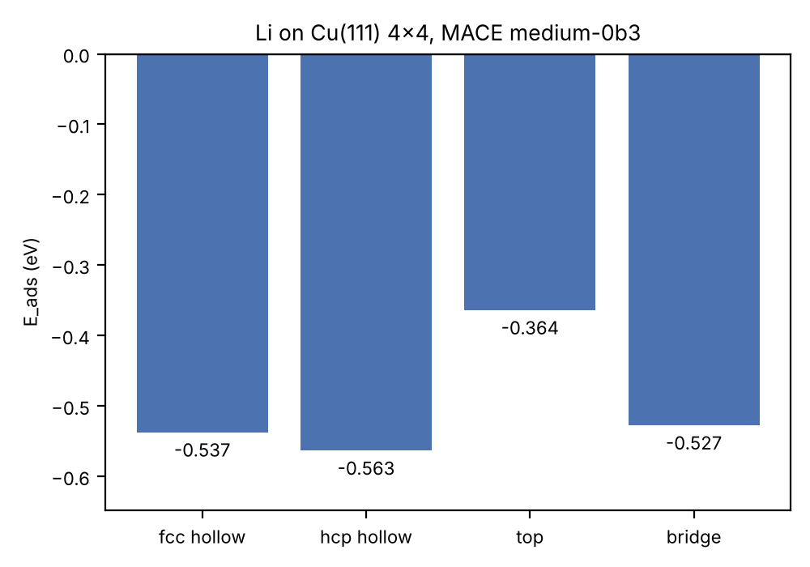
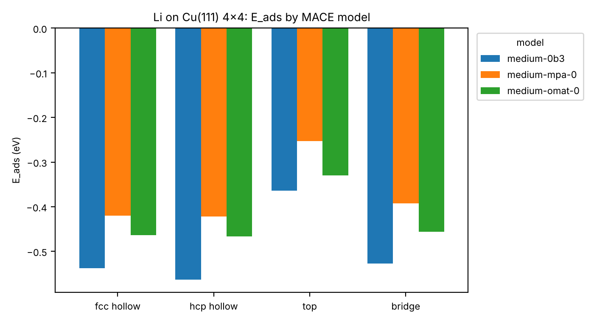

# Calculation

adsorption energy calculation

사전학습 범용 머신러닝 포텐셜(uMLIP) MACE로 Cu(111) 표면 위 Li 원자 1개의 흡착 에너지를 자리별로 계산한다. GPU 없이 CPU만으로 실행한다.

## 실행 방법

```bash
python3 -m venv .venv
source .venv/bin/activate
pip install torch --index-url https://download.pytorch.org/whl/cpu   # CPU 전용 PyTorch
pip install -r requirements.txt
python adsorption.py
```

- 처음 실행할 때 MACE 체크포인트(약 76 MB)를 GitHub release에서 `~/.cache/mace/`로 자동으로 받는다.
- 표면 금속, 흡착 원자, 슬랩 크기, 층수, 진공 두께, 고정 층수, 수렴 기준, 모델은 `adsorption.py` 맨 위 변수에서 바꾼다.

다른 모델로 같은 계산을 하고 결과를 검증·비교하려면:

```bash
python adsorption.py --model medium-mpa-0  --out results/models/medium-mpa-0
python adsorption.py --model medium-omat-0 --out results/models/medium-omat-0
python verify.py results results/models/medium-mpa-0 results/models/medium-omat-0
```

> 참고: 이번 실행 환경(Claude Code 클라우드 세션)에서는 `download.pytorch.org`가 네트워크 정책으로 막혀 있었다. 그래서 PyPI 기본 `torch` 휠(`2.14.1+cu130`)을 설치했다. GPU가 없으니 CUDA는 쓰지 않았고(`torch.cuda.is_available() == False`) 계산은 모두 CPU에서 했다.

## 계산 조건

| 항목 | 값 |
|---|---|
| 모델 | MACE-MP-0b3 medium (`mace_mp(model="medium-0b3")`, [mace_mp_0b3 release](https://github.com/ACEsuit/mace-mp/releases/tag/mace_mp_0b3)) |
| 소프트웨어 | mace-torch 0.3.16, torch 2.14.1, ase 3.29.0, e3nn 0.4.4, float64 |
| 하드웨어 | CPU 4 스레드, GPU 없음 |
| 표면 | Cu(111), 4×4, 4층(64 원자), 진공 15 Å(ASE `fcc111` 기준 위아래 각각), 아래 2층 고정 |
| 격자상수 | MACE로 최적화한 Cu fcc a = 3.614 Å |
| 흡착 원자 | Li 1개, 초기 높이 2.0 Å |
| 흡착 자리 | fcc hollow, hcp hollow, top, bridge |
| 최적화 | BFGS, fmax = 0.05 eV/Å (bulk는 셀까지 포함해 0.01 eV/Å) |
| 기준 에너지 | 깨끗한 슬랩(같은 조건으로 최적화), Li bcc bulk 원자당 에너지(a = 3.417 Å, −1.9008 eV/atom) |

E_ads = E(slab+Li) − E(slab) − E(Li bulk, 원자당)

E_ads가 음수이면, Li가 bulk 금속 Li로 있을 때보다 Cu 표면에 흡착했을 때 더 안정하다는 뜻이다.

## 결과

| 흡착 자리 | E_ads (eV) | 표면에서 Li까지 높이 (Å) | BFGS steps | 계산 시간 (s) |
|---|---:|---:|---:|---:|
| fcc hollow | −0.537 | 2.061 | 4 | 5.5 |
| **hcp hollow** | **−0.563** | 2.051 | 4 | 4.1 |
| top | −0.364 | 2.022 | 12 | 11.1 |
| bridge | −0.527 | 2.068 | 5 | 4.8 |

- 높이는 최적화 후 Li의 z 좌표에서 맨 위 Cu 층 평균 z를 뺀 값이다.
- 자리 간 안정성 순서는 hcp ≳ fcc > bridge ≫ top이다. hcp와 fcc의 차이(약 26 meV)는 모델 오차 범위 안일 수 있다.
- 최적화하는 동안 Li의 수평 이동은 모두 0.01 Å 이하였다. top과 bridge는 대칭 때문에 수평 힘이 0이라 그 자리에 머문 것이다. 아래 [결과 검증](#결과-검증)에서 Li를 옆으로 밀고 다시 최적화해 보니, 두 자리 모두 hollow로 미끄러졌다. 즉 둘 다 안정한 흡착 자리가 아니다.

**계산 시간**(CPU 4 스레드): bulk 기준 1.3 s, 깨끗한 슬랩 1.5 s(초기 힘이 이미 fmax보다 작아 0 step), 흡착 4개 자리 합계 25.5 s다. 모델 로딩까지 포함한 전체 실행은 약 38 s다(모델 다운로드 시간 제외).



### 결과 파일 (`results/`)

| 파일 | 내용 |
|---|---|
| `adsorption_energies.csv` | 자리별 E_ads, 높이, 수평 이동, step 수, 시간, 총에너지 |
| `adsorption_energies.png` | 자리별 E_ads 막대그래프 |
| `Cu111_Li_<site>.traj`, `clean_slab.traj` | BFGS 최적화 궤적(ASE trajectory, 마지막 프레임이 최종 구조) |
| `POSCAR/POSCAR_<name>` | 최종 구조(VASP POSCAR, direct 좌표) |
| `logs/*.log` | BFGS 로그 |
| `run_info.json` | 모델, 패키지 버전, 설정, 기준 에너지 |
| `geometry_check.csv` | Li–Cu 최근접 거리, 수평 이동, 최종 자리 판정, 높이 정의별 값 (`verify.py`) |
| `lattice_check.csv` | 기준 격자상수 확인 (`verify.py`) |
| `perturbation_check.csv`, `perturbed_*.traj` | Li를 옆으로 민 뒤 재최적화한 결과 (`verify.py`) |
| `model_comparison.csv`, `model_comparison.png` | 세 모델의 E_ads 비교 |
| `models/medium-mpa-0/`, `models/medium-omat-0/` | 다른 모델로 계산한 같은 구성의 결과 |

## 결과 검증

`verify.py`로 확인했다. 아래 표의 값은 별도 언급이 없으면 MACE-MP-0b3 medium 결과다.

### 1. Li–Cu 거리, 수평 이동, 자리 판정

| 시작 자리 | d1 (Å) | d2 (Å) | d3 (Å) | 최적화 중 수평 이동 (Å) | 최종 자리 판정 |
|---|---:|---:|---:|---:|---|
| fcc hollow | 2.557 | 2.557 | 2.557 | 0.000 | fcc hollow |
| hcp hollow | 2.550 | 2.550 | 2.550 | 0.000 | hcp hollow |
| top | 2.240 | 3.232 | 3.232 | 0.000 | top |
| bridge | 2.487 | 2.487 | 2.987 | 0.012 | bridge |

- d1–d3는 Li에서 가장 가까운 Cu 원자 3개까지의 거리(주기 경계 포함)다. 거리 패턴도 각 자리의 배위수와 맞다. hollow는 같은 거리 3개, bridge는 2개, top은 1개다.
- 최종 자리 판정은 최적화 후 Li의 xy 위치에서 가장 가까운 기준점으로 정했다. 기준점은 top(1층 Cu 위), bridge(1층 Cu–Cu 중점), hcp(2층 Cu 위), fcc(3층 Cu 위)다.
- **최적화 중에는 bridge와 top 모두 미끄러지지 않았다.** 하지만 이는 대칭 때문에 수평 힘이 정확히 0이어서 BFGS가 대칭을 깨지 못한 결과다. 그 자리가 안정하다는 뜻이 아니다.

**섭동 시험**: Li를 옆으로 0.2 Å 밀고 fmax 0.01 eV/Å로 다시 최적화했다. hollow와 top은 x축에서 17° 방향으로 밀었다. bridge는 두 Cu를 잇는 축에 수직인 양쪽(±)으로 각각 밀었다.

| 시작 자리 (민 방향) | MP-0b3 | MPA-0 | OMAT-0 |
|---|---|---|---|
| fcc hollow | fcc로 복귀 | fcc로 복귀 | fcc로 복귀 |
| hcp hollow | hcp로 복귀 | hcp로 복귀 | hcp로 복귀 |
| top | **fcc로 이동 (1.47 Å)** | **fcc로 이동 (1.49 Å)** | **fcc로 이동 (1.48 Å)** |
| bridge (+⊥) | **hcp로 이동 (0.71 Å)** | **fcc로 이동 (0.72 Å)** | **hcp로 이동 (0.72 Å)** |
| bridge (−⊥) | bridge 근처(0.2 Å)에서 멈춤* | **hcp로 이동 (0.72 Å)** | **fcc로 이동 (0.71 Å)** |

- **top은 세 모델 모두 불안정하다.** 조금만 밀어도 fcc hollow로 미끄러진다. 표의 top E_ads는 안정한 흡착 상태가 아니라 대칭으로 고정된 구조의 에너지다.
- **bridge도 안정한 흡착 자리가 아니다.** 어느 모델에서든 적어도 한 방향으로는 hollow로 미끄러진다. bridge는 fcc와 hcp 사이를 잇는 경로의 안장점에 해당한다.
- \* MP-0b3의 bridge(−⊥)는 추가로 확인했다. Li의 xy를 bridge→fcc 직선 위에 고정하고 나머지를 최적화하며 에너지를 따라가 보았다. 그 결과 E_ads는 −0.530(bridge) → −0.528(0.1–0.2 Å) → −0.539 eV(fcc, 0.72 Å)로, 약 2 meV짜리 작은 언덕이 있었다. 섭동 계산은 이 언덕 꼭대기(힘 0.009 eV/Å)에서 수렴 판정이 난 것이다. 2 meV는 모델 정확도보다 훨씬 작은 차이라 의미를 두기 어렵다.
- hollow 자리들은 다시 최적화해도 원래 자리에서 0.05 Å 안쪽으로 돌아왔고, 에너지 변화도 3 meV 이하였다. 다만 표면 위 퍼텐셜 에너지 곡면이 매우 평평해서, fmax 0.05로는 위치가 0.2 Å 정도 어긋난 채로 수렴 판정이 나기도 했다.

### 2. 높이 정의

README와 `adsorption_energies.csv`의 "높이"는 **Li의 z − 맨 위 Cu 층(16개 원자) 평균 z**(`h_layer`)다. 비교를 위해 두 가지 정의를 더 계산했다.

| 자리 | h_layer: 맨 위 층 평균 기준 (Å) | h_coord: 배위 Cu 평균 기준 (Å) | Li 바로 아래 Cu | h_below: 바로 아래 Cu 기준 (Å) |
|---|---:|---:|---|---:|
| fcc hollow | 2.061 | 2.082 | 3층 Cu (xy 0.00 Å) | 6.240 |
| hcp hollow | 2.051 | 2.070 | 2층 Cu (xy 0.00 Å) | 4.160 |
| top | 2.022 | 2.240 | 1층 Cu (xy 0.00 Å) | 2.240 |
| bridge | 2.068 | 2.118 | 2층 Cu (xy 0.73 Å) | 4.178 |

- `h_coord`는 Li와 결합한 Cu(hollow는 3개, bridge는 2개, top은 1개)의 평균 z를 기준으로 잰 높이다. Li가 있으면 바로 밑의 Cu가 조금 아래로 눌리기 때문에 `h_layer`보다 0.02–0.22 Å 크다. top에서 차이가 가장 크다.
- `h_below`는 xy가 가장 가까운 Cu 중 가장 위에 있는 원자를 기준으로 잰 높이다. hollow와 bridge 자리에서는 Li 바로 아래가 맨 위 층이 아니라 2층·3층 Cu여서, 이 값은 표면 위 높이로 쓸 수 없다. top 자리에서만 `h_below` = `h_coord` = Li–Cu 결합 길이(2.240 Å)로 의미가 있다.

### 3. 기준 격자상수

| 항목 | 사용한 값 | 실험값 (실온) | 어떻게 얻었나 | 확인 |
|---|---:|---:|---|---|
| Cu fcc a | 3.6140 Å | 3.615 Å | MACE로 bulk 셀 최적화 (`FrechetCellFilter` + BFGS) | a × 0.99 / 1.01에서 에너지가 각각 +4.9 / +4.5 meV/atom 높아 a가 최소점이다. 슬랩 POSCAR 셀에서 거꾸로 계산한 a도 3.6140 Å로 같다. |
| Li bcc a | 3.4165 Å | 3.51 Å | MACE로 bulk 셀 최적화 | ±1%에서 +0.8 meV/atom으로 최소점이다. E(Li bulk)/atom = −1.9008 eV |

- 두 격자상수 모두 **실험값이 아니라 같은 모델로 최적화한 값**이다. 슬랩, 흡착 구조, 기준 bulk가 모두 같은 모델의 평형 격자 위에서 계산되도록 맞춘 것이다.
- 모델별 최적 격자상수: MPA-0는 Cu 3.6392 / Li 3.4271 Å, OMAT-0는 Cu 3.6327 / Li 3.4265 Å다. 각 모델은 자기 격자상수로 슬랩을 다시 만들었다.
- 세 모델 모두 Li bcc 격자상수를 실험값보다 약 2.5% 작게 예측한다. 학습 데이터의 DFT(PBE) 값과 비슷한 경향이다.

### 4. 모델 비교

| 자리 | MACE-MP-0b3 medium | MACE-MPA-0 medium | MACE-OMAT-0 medium |
|---|---:|---:|---:|
| fcc hollow | −0.537 | −0.420 | −0.464 |
| hcp hollow | **−0.563** | **−0.422** | **−0.467** |
| top* | −0.364 | −0.253 | −0.330 |
| bridge* | −0.527 | −0.392 | −0.456 |
| hcp − fcc (meV) | −26 | −2 | −3 |
| 높이 h_layer, hcp (Å) | 2.051 | 2.056 | 2.081 |

E_ads 단위는 eV다. \* top과 bridge는 안정한 흡착 자리가 아니다(1번 참고).



- **세 모델 모두 순서가 같다.** hcp ≈ fcc > bridge > top이다. hollow 자리가 가장 안정하고, top이 가장 불리하다.
- **절대값은 모델마다 0.1 eV 넘게 다르다.** hollow 기준 MP-0b3 −0.56, OMAT-0 −0.47, MPA-0 −0.42 eV다. 이 차이가 사전학습 uMLIP의 불확실성 규모를 보여준다.
- fcc와 hcp의 차이는 MPA-0과 OMAT-0에서 2–3 meV로 사실상 0이다. MP-0b3만 26 meV로 hcp를 선호한다. 따라서 **fcc와 hcp 중 어디가 더 안정한지는 이 계산으로 결론 낼 수 없다.**
- OMAT-0 medium은 Academic Software License(ASL) 모델이다. 실행하면 라이선스 동의 문구가 출력된다.
- 계산 시간(4개 자리 최적화 합계): MP-0b3 25.5 s, MPA-0 46.3 s, OMAT-0 116.1 s다. 단, MPA-0와 OMAT-0는 다른 검증 계산과 CPU를 함께 쓰면서 돌았기 때문에 시간이 부풀려져 있다. 세 모델 모두 medium 크기라 단독으로 돌리면 비슷할 것으로 예상하지만 직접 확인하지는 않았다.

## 한계

- **사전학습 uMLIP 결과는 경향 비교용이다.** MACE-MP-0b3는 Materials Project(PBE/PBE+U) bulk 데이터 위주로 학습했다. 표면이나 흡착 에너지의 절대값에는 수십~수백 meV 수준의 오차가 있을 수 있다. 정확한 값이 필요하면 같은 구조(`results/POSCAR/`)로 DFT 계산을 해서 검증해야 한다.
- **단일 Li 원자 흡착이다.** 4×4 셀에 Li 1개(커버리지 1/16 ML)만 넣었기 때문에, Li 사이 상호작용이나 커버리지가 높아질 때의 효과는 반영되지 않았다.
- 슬랩 4층에 아래 2층을 고정했고, 영점 에너지와 온도 효과는 넣지 않았다. top과 bridge가 안정한 자리가 아니라는 판단은 섭동 시험으로 한 것이다. 진동수(Hessian) 분석은 하지 않았다.
- 세 모델의 hollow 자리 E_ads가 0.1–0.15 eV씩 차이 난다. 모델 하나의 절대값만 보고 결론을 내리면 안 된다.
