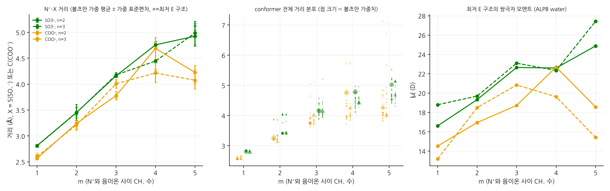
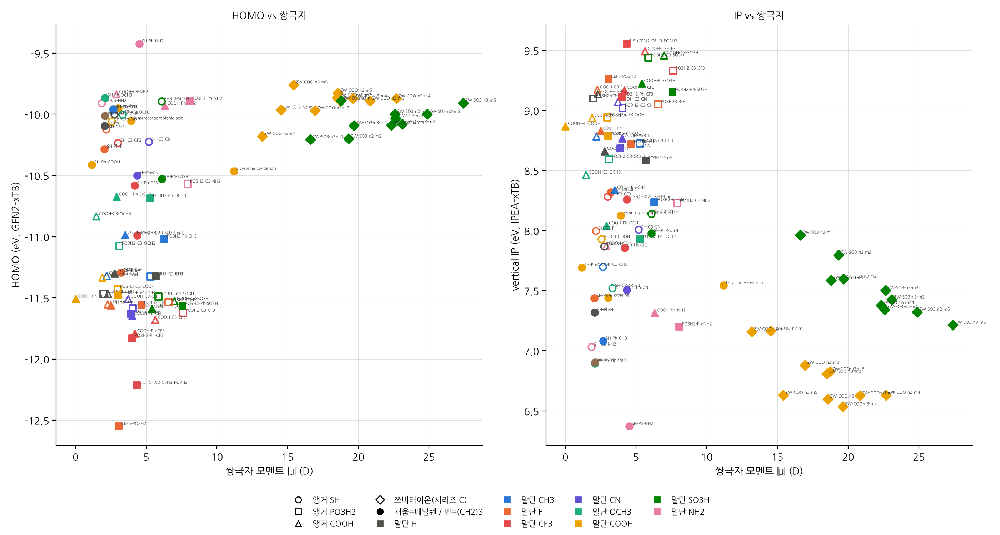
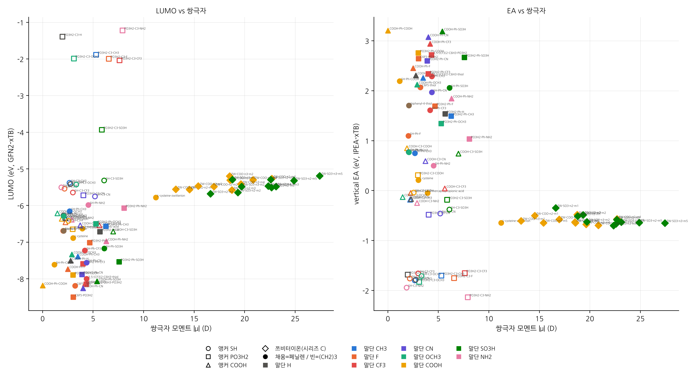
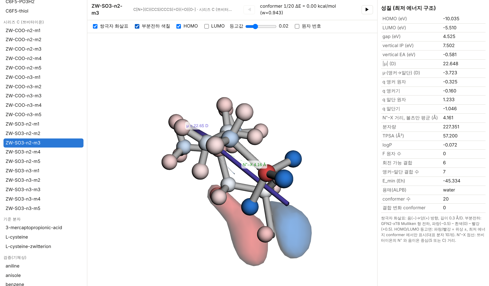
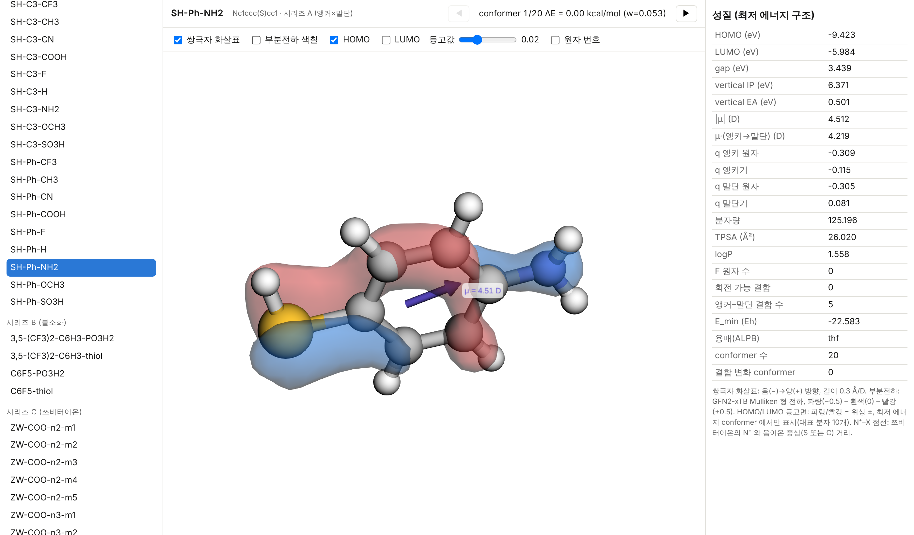

# SAM 후보 분자 기술자(descriptor) 지도

음극/양극 계면용 자기조립단분자막(SAM) 후보 분자 87종(+사용자 추가분)에 대해 **RDKit + GFN2-xTB(CPU)** 로
2D/3D 기술자를 계산하고, 지도(그림)와 3D 뷰어(`viewer.html`)로 정리한 파이프라인입니다.

---

## 0. 계산 흐름 (초보자용)

한 분자는 아래 네 단계를 거칩니다. 괄호 안이 실제 코드 위치입니다.

```
SMILES ──① 파싱·정규화──▶ RDKit Mol ──② conformer 생성──▶ 3D 좌표 20개
      ──③ xTB 최적화──▶ 최저 에너지 구조 ──④ 성질 계산──▶ summary 한 줄
```

| 단계 | 하는 일 | 함수 (파일) |
|---|---|---|
| ① SMILES → 분자 | SMILES 문자열을 RDKit 이 읽고(원자가·방향족성 검사), 수소를 붙이고, 앵커/말단 원자 번호를 기록. 라디칼이 생기면 오류로 걸러냄 | `parse_entry()` (`library.py`) · 새 분자는 `auto_annotate()`, `make_row()` (`compute.py`) |
| ① RDKit 기술자 | 분자량, TPSA, logP, F 수, 회전 가능 결합 수, 앵커–말단 결합 수(최단 경로) | `rdkit_descriptors()` (`compute.py`) |
| ② conformer 생성 | ETKDGv3 로 20개 3D 구조를 만들고 MMFF94s 로 거칠게 다듬음 | `generate_conformers()` (`compute.py`) |
| ③ xTB 최적화 | conformer 하나마다 GFN2-xTB(+ALPB 암묵용매) 에너지·힘을 tblite 로 계산하고 ASE LBFGS 로 구조 최적화. 최적화 뒤 결합 연결이 바뀌었는지 검사 | `xtb_optimize()`, `check_connectivity()` (`compute.py`) |
| ④ 성질 | 최저 에너지 구조에서 HOMO/LUMO/gap, 쌍극자(크기·앵커→말단 성분), 부분전하(앵커 원자·앵커기·말단 원자·말단기). xtb 바이너리로 vertical IP/EA(IPEA-xTB)와 molden 파일 | `xtb_properties()`, `xtb_binary_ipea()` (`compute.py`) |
| ①–④ 묶음 | 분자 한 개 = row(dict) 하나 처리 | `process_molecule()` (`compute.py`) |
| 새 분자 한 개 | SMILES + 이름만 주면 위 전부 실행 | **`compute_molecule(smiles, name, solvent)`** (`compute.py`) |
| 전체 라이브러리 | 4개 프로세스로 병렬 실행, 진행 로그 출력 | `run()` (`run_pipeline.py`) |
| 시리즈 C 분석·그림·표 | 볼츠만 평균, 지도, 표 | `analyze.py` |
| 궤도 등고면 | molden → cube (pyscf) | `cubes.py` |
| 뷰어 | `viewer.html` 생성 | `viewer.py` |

실행 순서(전체 재현):

```bash
pip install -r requirements.txt          # + xtb 바이너리 (아래 "환경")
python library.py                        # library.csv
python run_pipeline.py                   # 87개 분자, ~4 분 (4 코어)
python run_pipeline.py --convergence     # 20 vs 50 conformer 검증 (5개 분자)
python cubes.py                          # 대표 분자 10개 HOMO/LUMO cube
python analyze.py                        # figures/, results/tables.md
python viewer.py                         # viewer.html
```

---

## 1. 환경

| 항목 | 사용한 것 |
|---|---|
| Python 패키지 | rdkit 2026.9, ase 3.29, **tblite 0.8.0 (pip, ASE 계산기 포함)**, pandas, matplotlib, py3Dmol, pyscf 2.14(cube 생성용) |
| xTB 엔진 (최적화·HOMO/LUMO·전하·쌍극자) | **tblite** 를 파이썬 안에서 직접 호출 (GFN2-xTB, ALPB). 설치가 pip 로 바로 되어 이것을 1순위로 사용 |
| xTB 바이너리 (IP/EA, molden) | tblite 에는 IPEA-xTB 와 molden 출력이 없어서 **GitHub release `xtb 6.7.1` 리눅스 바이너리**를 `/opt/xtb` 에 받아 `--vipea`, `--molden` 에만 사용. 같은 구조에서 두 프로그램의 HOMO/LUMO 가 소수 셋째 자리까지 일치함을 확인(87개 전부) |
| 하드웨어 | CPU 4코어, GPU 없음. 87개 분자 × 20 conformer 전체가 약 4분(병렬), 누적 CPU 시간 약 13분 |

용매(ALPB): 시리즈 A·B·기준(중성) = **THF**(DME 대용), 시리즈 C·cysteine 쯔비터이온 = **water**, 검증 세트 = 기체상(실험 IP 가 기체상 값이라서).
시리즈 C 는 기체상 계산을 하지 않았습니다(쯔비터이온 붕괴/양성자 이동 위험).

---

## 2. 분자 라이브러리 (`library.csv`)

| 시리즈 | 구성 | 개수 (고유) |
|---|---|---|
| A | 앵커 {SH, PO3H2, COOH} × 스페이서 {para-phenylene, (CH2)3} × 말단 {H, CH3, F, CF3, CN, OCH3, COOH, SO3H, NH2} | 54 |
| B | C6F5–SH, 4-CF3-C6H4–SH, 4-F-C6H4–SH, 3,5-(CF3)2-C6H3–SH 와 대응 포스폰산 4종 | 8 (4) |
| C | HS-(CH2)n-N⁺(CH3)2-(CH2)m-SO3⁻ / -COO⁻, n = 2,3, m = 1–5 | 20 |
| 기준 | L-cysteine(중성·쯔비터이온), 3-mercaptopropionic acid, thiophenol | 4 (3) |
| 검증 | benzene, toluene, phenol, anisole, aniline, thiophenol (기체상) | 6 |

- 모든 SMILES 를 RDKit 로 파싱·정규화했고 **파싱 실패는 0건**입니다. 
- 같은 정규화 SMILES 로 겹친 항목 5개는 한 번만 계산했습니다: 4-CF3-C6H4-thiol = SH-Ph-CF3, 4-F-C6H4-thiol = SH-Ph-F, 4-CF3-C6H4-PO3H2 = PO3H2-Ph-CF3, 4-F-C6H4-PO3H2 = PO3H2-Ph-F, thiophenol = SH-Ph-H (`duplicate_of` 열).
- 조합 중 "불가능"해서 뺀 것은 없습니다. COOH-Ph-COOH(테레프탈산), COOH-C3-COOH(글루타르산)처럼 앵커·말단이 같은 대칭 분자도 포함했습니다.
- 앵커 원자 = S / P / 카복실 C, 말단 원자 = 말단기 중심 원자(CF3 의 C, SO3H 의 S, OCH3 의 O, CN 의 C …), 말단 -H 는 para 수소. 시리즈 C 의 말단 원자 = S(SO3⁻) 또는 C(COO⁻).

---

## 3. 방법 요약

- **conformer**: ETKDGv3, 분자당 20개(pruneRms 0.1 Å), MMFF94s 사전 최적화.
- **최적화**: GFN2-xTB + ALPB, ASE LBFGS, 수렴 기준 fmax 0.05 eV/Å(≈ xtb "normal"). 실패 시 FIRE 로 재시도.
- **결합 연결 검사**: 최적화 구조에서 공유결합 반지름 합 × 1.25 이내를 결합으로 보고 RDKit 토폴로지와 비교. 바뀐 conformer 는 최저 구조 선택과 볼츠만 평균에서 제외하고 `results/connectivity_changes.csv` 에 기록.
- **성질**: 최저 에너지 conformer 에서 HOMO/LUMO(궤도 에너지·점유수), 쌍극자 벡터(음→양), GFN2 부분전하. 앵커→말단 성분 = μ·û (û: 앵커 원자→말단 원자 단위벡터, 양수면 말단 쪽이 +).
- **IP/EA**: xtb `--vipea`(IPEA-xTB, 같은 ALPB 용매), 최저 구조에서 수직 값.
- **시리즈 C**: 모든 conformer 의 N⁺–X 거리를 298 K 볼츠만 가중(xTB 용매상 에너지)으로 평균·표준편차.

---

## 4. 결과

전체 표(87개 분자 × 20여 열)는 [`results/tables.md`](results/tables.md), 원자료는 `results/summary.csv`
(분자별 conformer 상세: `results/molecules/*.json`).

### 4.1 시리즈 A 경향 (평균, THF)

| 앵커 | HOMO (eV) | IP (eV) | LUMO (eV) | μ (D) |
|---|---|---|---|---|
| SH | −10.11 | 7.59 | −6.19 | 3.26 |
| COOH | −11.23 | 8.76 | −7.08 | 3.38 |
| PO3H2 | −11.28 | 8.71 | −5.03 | 5.21 |

| 말단 | HOMO (eV) | IP (eV) | μ·(앵커→말단) (D) |
|---|---|---|---|
| CF3 | −11.29 | 8.87 | −3.86 |
| CN | −11.18 | 8.51 | −2.98 |
| SO3H | −11.10 | 8.90 | −1.67 |
| F | −11.10 | 8.53 | −1.13 |
| COOH | −11.04 | 8.53 | +0.61 |
| H | −10.94 | 8.44 | +1.61 |
| CH3 | −10.76 | 8.14 | +1.61 |
| OCH3 | −10.52 | 7.91 | +2.44 |
| NH2 | −9.93 | 7.34 | +3.90 |

전자 끌개(CF3, CN, SO3H, F)일수록 HOMO 가 깊고 IP 가 커서(산화 안정성 지표 ↑) 쌍극자가 말단→앵커 방향(음수)이 되고,
전자 주개(NH2, OCH3)는 반대입니다. 티올 앵커는 S 고립전자쌍 때문에 HOMO 가 가장 얕습니다.

### 4.2 시리즈 B (불소화)

| 분자 | HOMO | IP | LUMO | EA | μ |
|---|---|---|---|---|---|
| C6F5-thiol | −11.29 | 8.32 | −8.19 | 2.07 | 3.21 |
| 3,5-(CF3)2-C6H3-thiol | −10.99 | 8.26 | −8.00 | 2.29 | 4.34 |
| C6F5-PO3H2 | −12.55 | 9.26 | −8.50 | 2.64 | 3.04 |
| 3,5-(CF3)2-C6H3-PO3H2 | −12.21 | 9.56 | −8.15 | 2.72 | 4.33 |
| (참고) SH-Ph-CF3 | −10.58 | 7.86 | −7.23 | 1.61 | 4.18 |
| (참고) SH-Ph-F | −10.28 | 7.44 | −6.69 | 1.10 | 2.04 |

다중 불소화는 HOMO 를 1 eV 가까이 내리고 LUMO/EA 도 크게 내립니다(환원에는 취약해질 수 있음).

### 4.3 시리즈 C (쯔비터이온, water)



- N⁺–X 거리의 볼츠만 평균은 m = 1→4 에서 거의 선형(2.6 → 4.7 Å)으로 늘다가 m = 5 에서 COO⁻ 계열은 사슬이 접혀(4.1–4.2 Å) 오히려 줄고, SO3⁻ 계열은 계속 늘어 5.0 Å 에 이릅니다.
- 쌍극자는 13–27 D 로 중성 분자(2–7 D)보다 훨씬 크고, 대체로 m 과 함께 커집니다(최저 구조 하나의 값이라 m = 5 에서 접힘에 민감).
- 표: `results/tables.md` "시리즈 C" 절, conformer 전체: `results/seriesC_conformers.csv`.

### 4.4 기준 분자

| 분자 | HOMO | IP | μ (D) | 비고 |
|---|---|---|---|---|
| thiophenol (= SH-Ph-H) | −10.09 | 7.32 | 2.06 | THF |
| 3-mercaptopropionic acid | −10.05 | 8.13 | 3.92 | THF |
| L-cysteine (중성) | −9.95 | 7.44 | 3.02 | THF |
| L-cysteine (쯔비터이온) | −10.46 | 7.54 | 11.19 | water, N⁺–C(COO⁻) 2.44 Å |

### 4.5 지도

HOMO(왼쪽)·IP(오른쪽) vs 쌍극자. 모양 = 앵커(○ SH, □ PO3H2, △ COOH, ◇ 쯔비터이온), 색 = 말단, 채움 = 페닐렌 / 빈 = (CH2)3.



LUMO·EA vs 쌍극자:



---

## 5. 검증

### 5.1 실험 IP 와 비교 (기체상)

| 분자 | 실험 IP (eV) | IPEA-xTB IP | −ε(HOMO) GFN2 |
|---|---|---|---|
| benzene | 9.24 | 10.22 | 10.95 |
| toluene | 8.83 | 9.75 | 10.61 |
| phenol | 8.49 | 9.71 | 10.43 |
| thiophenol | 8.30 | 9.15 | 10.14 |
| anisole | 8.20 | 9.35 | 10.27 |
| aniline | 7.72 | 8.85 | 9.67 |

IPEA-xTB IP: Spearman ρ = 0.94, Pearson r = 0.96, **MAE 1.0 eV (일정하게 과대평가)**. −ε(HOMO): ρ = 0.94. 절대값은 어긋나지만 순서는
phenol/anisole 한 쌍만 빼고 맞아, 경향 비교용으로 쓸 수 있습니다. (`figures/validation_ip.png`)

### 5.2 conformer 20 → 50

| 분자 | E_min(20) − E_min(50) | HOMO 20/50 | μ 20/50 | 같은 구조? |
|---|---|---|---|---|
| SH-Ph-CF3 | 0.01 kcal/mol | −10.58 / −10.58 | 4.18 / 4.16 | 예 |
| COOH-C3-SO3H | 0.00 | −11.53 / −11.53 | 6.99 / 6.99 | 예 |
| L-cysteine-zwitterion | 0.00 | −10.46 / −10.46 | 11.19 / 11.19 | 예 |
| PO3H2-C3-OCH3 | 0.81 | −11.08 / −11.05 | 3.09 / 6.01 | **아니오** |
| ZW-SO3-n3-m4 | 3.23 | −10.09 / −9.91 | 22.34 / 22.69 | **아니오** |

강직한 분자는 20개로 충분하지만, **회전 가능 결합이 6개 이상인 유연한 사슬(긴 알킬 포스폰산, 시리즈 C 의 m ≥ 4)** 은 50개에서 더 낮은
구조가 나왔습니다. HOMO 변화는 0.2 eV 이내지만 쌍극자는 conformer 에 민감합니다(PO3H2-C3-OCH3 3.1 → 6.0 D). 이런 분자는
`--nconf 50` 이상을 권하며, 볼츠만 평균값(시리즈 C 거리)이 단일 최저 구조보다 안정적입니다.

### 5.3 최적화 후 결합 연결 변화

최종 결과에서는 **0건**입니다(`results/connectivity_changes.csv` 비어 있음). 개발 중 앵커 SMILES 조립 버그(COOH/PO3H2 가 C 가 아닌
O 로 이어져 포름산 에스터 라디칼이 됨)가 이 검사와 "라디칼 전자" 검사로 드러나 고쳤습니다.

---

## 6. viewer.html

`viewer.html` 하나만 브라우저로 열면 됩니다(3Dmol.js 포함, 3.6 MB, 인터넷 불필요).



- **왼쪽**: 시리즈별 분자 목록, 이름·SMILES 검색.
- **가운데**: 3D 구조(마우스로 회전·확대). ◀ ▶ 또는 방향키로 conformer 넘기기(에너지 순, ΔE kcal/mol 과 볼츠만 가중치 표시).
  체크박스로 쌍극자 화살표(음→양, 0.3 Å/D), 부분전하 색칠(파랑 − / 빨강 +), HOMO/LUMO 등고면(대표 분자 10개, 등고값 슬라이더), 원자 번호.
- **오른쪽**: HOMO, LUMO, gap, IP/EA, 쌍극자, 부분전하, TPSA, logP 등.
- 쯔비터이온은 N⁺와 음이온 중심(S/C) 사이를 초록 점선과 거리로 표시.



파일: 최종 구조 `xyz/<name>.xyz`, 궤도 `molden/<name>.molden`(Avogadro: File → Open), cube `cubes/<name>_homo.cube`, `_lumo.cube`.

---

## 7. 새 분자 추가하기

### 7.1 로컬 CLI

```bash
python add_molecule.py --smiles "Sc1ccc(-c2ccccc2)cc1" --name "biphenyl-4-thiol"
```

- 옵션: `--solvent thf|water|gas`(생략 시 쯔비터이온→water, 그 외→thf), `--nconf 50`, `--force`(재계산), `--no-refresh`.
- 결과는 `results/database.csv` 에 한 줄 추가되고(상세 JSON·xyz·molden 도 저장), 같은 정규화 SMILES 가 이미 `database.csv` 나
  `summary.csv` 에 있으면 계산하지 않고 저장값을 보여 줍니다.
- 추가 후 `figures/map_homo_vs_dipole.png`, `map_lumo_vs_dipole.png`, `viewer.html` 이 자동으로 다시 만들어집니다(목록의 "사용자 추가" 그룹).
- 파이썬에서 직접: `from compute import compute_molecule; s = compute_molecule("OC(=O)CCS", "MPA", solvent="thf")`.
- 앵커/말단은 자동 인식(티올 S > 포스폰산 P > 카복실 C; 말단 = 앵커에서 가장 먼 작용기 중심). 직접 지정하려면 atom-map 을 붙입니다:
  `[SH:1]CCCC[C:2](=O)O` (1 = 앵커, 2 = 말단, 4 = N⁺).

### 7.2 Colab 노트북 `colab_add_molecule.ipynb`

[Colab 에서 열기](https://colab.research.google.com/github/wj7294-blip/Calculation/blob/main/sam_descriptors/colab_add_molecule.ipynb)

1. 맨 위 셀에서 SMILES, 이름, 용매(auto/thf/water/gas), conformer 수를 입력.
2. 런타임 → 모두 실행: pip 설치 + xtb 바이너리 다운로드 → 이 저장소 clone → Google Drive 마운트 → 계산 → 표·3D 구조·지도 표시.
3. `database.csv`, 분자 JSON, xyz, `viewer.html` 이 `MyDrive/sam_descriptors/` 에 저장되고, 다음 실행 때 자동으로 불러와 중복 계산을 피합니다.

---

## 8. 파일 구조

```
sam_descriptors/
├── library.py            # 라이브러리 생성 (SMILES 조립·검증) → library.csv
├── compute.py            # 분자 1개 계산: compute_molecule(), process_molecule() 등
├── run_pipeline.py       # 전체 병렬 실행, 진행 로그, --convergence
├── add_molecule.py       # 새 분자 추가 CLI (database.csv, 지도·뷰어 자동 갱신)
├── analyze.py            # 그림·표
├── cubes.py              # molden → cube
├── viewer.py             # viewer.html 생성 (assets/3Dmol-min.js 포함)
├── colab_add_molecule.ipynb
├── results/summary.csv   # 87개 분자 요약;  database.csv = 사용자 추가분
├── results/tables.md     # 전체 표, 검증, 수렴, 시리즈 C
├── results/molecules/*.json  # 분자별 conformer 좌표·에너지·전하·쌍극자
├── results/convergence/  # 50-conformer 검증
├── logs/progress.log     # "[12/87] 이름 | conformer 20개 | 최저 E | HOMO | 시간"
├── figures/, xyz/, molden/, cubes/
└── viewer.html
```

---

## 9. 한계

- **단일 분자 계산입니다.** 금속·산화물 표면 흡착(Li, Cu, Al, LiCoO₂ 등)과 흡착 시 앵커 탈양성자화, 분자 간 패킹, 계면 전기장이 모두 빠져 있습니다.
  SAM 의 실제 일함수 변화·산화 안정성은 흡착 구조와 피복률에 크게 좌우되므로 여기 값은 **분자 고유 성질의 순위 비교**에만 쓰세요.
- **xTB 궤도 에너지와 궤도 모양은 정량값이 아니라 경향 비교용입니다.** GFN2-xTB 의 HOMO/LUMO 는 DFT/실험과 절대값이 다르고(검증 표에서 IP 가 약 1 eV 과대),
  gap 은 특히 신뢰도가 낮습니다. HOMO/LUMO 등고면은 xtb molden 을 pyscf 로 다시 읽어 그린 것이라 S, P 의 3s/3p/3d 기저는 근사적입니다.
- 암묵용매(ALPB THF/water)는 전해질(염, 농도, 전극 전위)을 대신하지 못합니다. 쯔비터이온은 용매·반대이온 없이 고립 상태라 쌍극자가 과대평가될 수 있습니다.
- conformer 20개는 유연한 분자(회전 가능 결합 ≥ 6)에 부족할 수 있습니다(5.2 절). 쌍극자는 conformer 에 민감하므로 단일 값 대신 분포를 보세요.
- IPEA-xTB 는 GFN1 기반 별도 매개변수화이며, 용매상 수직 IP/EA 의 절대값은 참고용입니다.
